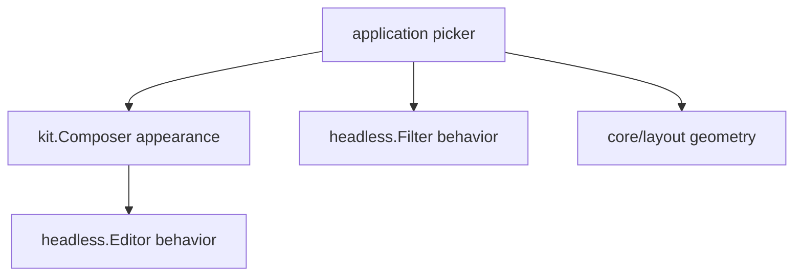

# Compose a themeable picker

Language: English | [简体中文](zh/components.md)

This tutorial turns the core component contract into a reusable interface without
giving product policy to the library. You will combine a text editor, fuzzy filter,
layout, focus, pointer routing, and a terminal-aware theme.

Complete code: [`examples/picker`](https://github.com/Tangerg/oolong/tree/main/examples/picker)

## Before you begin

Finish [Build your first interface](getting-started.md) first. This tutorial assumes
you know how `program.Run`, `Draw`, and `Handle` fit together.

Add the component module beside `core`:

```sh
go get github.com/Tangerg/oolong/core@latest
go get github.com/Tangerg/oolong/components@latest
```

Upgrade both modules together. Oolong modules share one coordinated release version.

## Keep each decision in one layer

The picker is a product component assembled from smaller framework components:



`Filter` owns matching, selection, and scrolling. It does not own the query editor or
the look of a row. The application owns both because only the application knows where
the query belongs and what choosing an item means.

## Resolve terminal facts once

Build appearance from the terminal driven by this runtime. Do not read process
environment variables inside a component because a local session and an SSH session
may describe different terminals.

```go
func newPicker(runtime *program.Runtime, items []string) *picker {
    theme := kit.Suited(runtime.Environment().Ground())
    glyphs := kit.GlyphsFor(runtime.Environment().Locale())

    p := &picker{runtime: runtime, theme: theme}
    p.query = kit.Composer{
        Theme:  theme,
        Prompt: glyphs.Marker + " ",
    }
    p.query.Editor().Placeholder = "type to narrow"
    p.configureItems(items)
    return p
}
```

`Theme` names semantic roles such as `Accent`, `Selection`, and `Danger`. `Glyphs`
answers a different question: which characters this terminal can represent.

## Let the filter own filtering

Configure state-changing behavior through methods. `SetItems` replaces the values and
the projection that says how they read as one source; `SetPattern` narrows that source.
Both invalidate the cached ranking, so no intermediate source can disagree with its
visible results.
Matching finishes before either change is published. If the text projection panics,
the previous source, pattern, matches and cursor remain intact. The projection must
be pure and cannot call SetItems or SetPattern on that filter.

```go
func (p *picker) configureItems(items []string) {
    p.list = &headless.Filter[string]{
        Row: p.drawRow,
    }
    p.list.SetItems(items, func(item string) string { return item })
}
```

The row callback is the appearance seam. It receives the item, fuzzy-match offsets,
and selection state. Draw the same behavior with a different shape by replacing this
callback, not by replacing `Filter`.

## Draw passive charts

Charts are completed content, not controllers. `Sparkline` and `BarChart` draw into a
`grid.View`, implement `headless.Block`, and own no selection, clock, or history. The
application retains the measurements and decides when they change.

```go
trend := kit.Sparkline{
    Theme: theme, Glyphs: glyphs,
    Values: []float64{0.12, 0.18, 0.15, 0.24, 0.31},
    Minimum: 0, Maximum: 1,
}

usage := kit.BarChart{
    Theme: theme, Glyphs: glyphs, Maximum: 100,
    Bars: []kit.Bar{
        {Label: "CPU", Value: 42, Text: "42%"},
        {Label: "RAM", Value: 68, Text: "68%"},
    },
}
```

Sparkline uses the newest samples that fit. A valid `Minimum`/`Maximum` pair fixes
its domain, as completion and resource metrics usually require; the zero pair derives
the scale from the visible window. BarChart is deliberately horizontal and
non-negative: it serves labelled dashboard comparisons without introducing axes, a
canvas, or a constraint solver. Compose either block inside `headless.Static`, a
transcript, a panel body, or any application-owned layout.

## Divide the assigned region

A headless widget draws into `headless.Frame`. The frame carries the same clipped
grid view as a core component plus the transaction used for input geometry.

```go
func (p *picker) Draw(frame headless.Frame) {
    rows := frame.Subs((layout.Flow{Axis: layout.Down}).Rects(frame.Bounds().Size(), []layout.Slot{
        {Size: layout.Fixed(1)},
        {Size: layout.Flex(1)},
        {Size: layout.Fixed(1)},
    }))
    p.query.Draw(rows[0])
    p.list.Draw(rows[1])
    kit.Label{
        Text:  fmt.Sprintf("%d of %d", p.list.Matched(), p.list.Len()),
        Style: p.theme.Subtle,
    }.Draw(rows[2].View)
}
```

The application chooses the vertical composition. Neither child needs to know what
is above or below it. Replace the slots with `layout.Across` to make a two-pane
interface without changing either child.

## Route events by ownership

Offer navigation keys to the list and text input to the composer. Handling and
changing are different facts: Backspace is handled at the beginning of an empty
editor but changes nothing. Compare `Editor.Revision` around input to publish the
pattern only when semantic content changed, without guessing from keys or action
names.

When a child callback replaces its attachment or changes outer focus, built-in
containers consume that interrupted key or action. Returning to the original child
or focus does not restore the old operation's authority to bubble. An unchanged
routing scope can still decline input normally. Root uses the committed tree's
identity; replacing pending content alone does not change that input scope.

```go
func (p *picker) Handle(event input.Event) bool {
    if key, ok := event.(input.Key); ok && key.Down() {
        switch key.Code {
        case input.Enter:
            p.choose()
            return true
        case input.Up, input.Down, input.PageUp, input.PageDown:
            return p.list.Handle(event)
        }
    }
    before := p.query.Editor().Revision()
    handled := p.query.Handle(event)
    if p.query.Editor().Revision() != before {
        p.list.SetPattern(p.query.Editor().Text())
    }
    return handled
}
```

For pointer input, stage child rectangles in a `headless.Snapshot` during `Draw` and
route against `Snapshot.Value` in `Handle`. The snapshot becomes visible only after
the complete root frame succeeds, so an event never sees half of a new layout. The
complete picker demonstrates this pattern.

## Install the headless root

`headless.NewRoot` is the only bridge from a live headless tree to
`program.Component`. It commits all nested presentation snapshots atomically.

```go
err := program.Run(context.Background(), program.Config{
    Root: func(runtime *program.Runtime) program.Component {
        return headless.NewRoot(newPicker(runtime, files()))
    },
    Terminal: term.Features{Probe: true, Mouse: true},
})
```

`program.Config.Terminal` accepts only optional `term.Features`. `Root` already means
alternate-screen ownership and `Inline` already means the ordinary terminal screen,
so there is no second `AltScreen` switch to keep consistent. A transport adapter uses
`program.Config.TerminalConfig()` when it acquires the underlying terminal session.

Passive content such as a finished Markdown document does not need this transaction.
Adapt it with `headless.Static` only when placing it inside a live widget tree.

## Change appearance without changing behavior

Copy a theme value and replace semantic roles:

```go
theme := kit.Suited(runtime.Environment().Ground())
theme.Accent = grid.Style{FG: grid.RGBColor(0xD7, 0x8B, 0xFF)}
theme.Selection = grid.Style{BG: grid.RGBColor(0x32, 0x27, 0x3B)}
```

Pass the modified value to kit components. Headless state remains unchanged. For a
fully custom design system, keep `components/headless` and draw every appearance seam
with your own package; `headless` never imports `kit`.

## Keep value identity and navigation explicit

A controlled field owns edits through its accessor. Configure `Select.Same` and
`MultiSelect.Same` before installing options; `headless.Equal[T]` compares ordinary
comparable values. Labels remain display text, so translating a label cannot change
which value is selected. `Chosen`, `Taken`, and `Ask` only project state. Select
reads its owner directly and needs no Sync. Text.Sync reconciles the editing model;
MultiSelect.Sync normalizes the caller's set at an explicit semantic boundary.

SetOptions prepares identity comparisons and required binding reads before replacing
the field's options and selection. If preparation panics or exits its goroutine,
the previous field remains intact. Once options are installed, normalization offers
a proposal to the controlled accessor; that accessor still owns the accepted answer.

Construct controlled fields with `NewText(TextConfig{Value: ...})`,
`NewSelect(SelectConfig[T]{Value: ...})`, `NewMultiSelect(MultiSelectConfig[T]{Value: ...})`,
or `NewConfirm(ConfirmConfig{Value: ...})`. Binding references are private; `SetBinding`
is their only replacement boundary. It cancels old key sequences and invalidates
validation. Nil retains the accepted answer in local state. Accessors containing
functions, maps or slices are supported without pointer or comparability restrictions.

Required reads and identity comparisons finish before a binding transfer publishes.
An abnormal exit preserves the previous owner, history and validation. Replacing an
idle accessor does not read its abandoned answer; returning to local state does.
Text settles an unfinished edit before transferring ownership.

After an accessor callback, Select and MultiSelect project the current owner,
including a transfer to local state. Controlled Select and MultiSelect keep no
writable answer mirror; navigation, Toggle and Reply submit private proposals to
the accessor. An unavailable single answer projects the first option; Validate or
replacing existing options offers it to the owner, and rejection remains invalid.
Changing the caller's single answer reveals its projected row on the next frame.
MultiSelect normalization does not resubmit a
proposal that is still inside Set. If normalization starts a newer semantic operation,
the interrupted Do or Toggle returns false, Handle consumes the event, and Reply
returns `headless.ErrValidationSuperseded` before applying the obsolete answer.
The field records an unfinished write under its binding's lifetime; replacing that
binding permits the new owner to normalize immediately.

Fields receive and forward focus before reconciling answers. Publishing a newer
answer from an accessor cannot reject the parent's focus notification. Blur checks
start only while that focus transfer is current; a later transfer, including away
and back, revokes an earlier check that has not started. Repeating the same focus
state creates no additional blur check. Once started, validation owns the checked
answer independently of focus.

Fields own validation publication. `Validate` and `Reply` return
`headless.ErrValidationSuperseded` when a callback starts a newer check or reply or
changes the answer being checked; the interrupted call retains the last published
field error. Form `Set`, `Add`, `Cancel`,
and a newer `Submit` revoke an active submission. It returns false without issuing
further checks or `Done`; replacing or adding fields also clears the form error.
`Field.Validation` returns a pure receipt for the last successful check, or nil
when none applies. A newer check or a different answer invalidates that receipt.
Form retains these receipts through later field and form callbacks, and completes
only while they all remain current. Custom fields must implement this contract;
Form cannot inspect or own their answers and does not retry stale validation.
If an accessor rejects normalization and retains an invalid value, validation returns
`headless.ErrInvalidBinding`. A single-line display, fallback choice or filtered set
cannot stand in for the application's accepted answer during submission.

`Text` exposes its answer, cursor, mask, clipboard, gutter and cursor style directly.
Use `SetText`, `SetCursor`, `Handle`, or `Do` to edit through the accessor's acceptance
boundary. `Text` does not expose its private Editor. `kit.Composer` still exposes its
Editor because the composer is an appearance wrapper around that editor.

A reentrant Text operation first settles the offered edit against the accepted
accessor value. An older call cannot roll back the new cursor or offer the new edit
again. `Text.Do` returns false if synchronization revokes it before dispatch.
If an accessor write panics or exits its goroutine, Text settles the draft, revision
and history against the accepted value. If that value is also unreadable, the edit
keeps its settlement until the next semantic operation can read it. Settlement does
not suppress abnormal exits.
Text's SetBinding starts new history and clears the old selection, so undo and a
pending Cut cannot write the previous owner's content into the new owner.
`Editor.Cut` returns false when its clipboard callback changes the content or selected
range; copying an old selection cannot authorize deleting a different one.

Moving a list selection or navigating an Editor cursor requests visibility once. `Scroll.Reveal` survives an aborted
frame and is consumed when a complete frame presents it. Subsequent manual scrolling
wins, and `Scroll.FollowingEnd` reports the follow policy. On `kit.Transcript`, set
`Current` to highlight a match and call `RevealMatch(index)` to navigate to one.
Editor requests resolve at the next frame's wrap width; resizing an already settled
view preserves manual scrolling. Filter query resets return to the first result.

Transcript presses and wheel input use the visible cells and targets of the last
complete frame. Drag continuation clamps to those visible cells. Replacing its
presented Content or Selection ends that gesture's coordinate lifetime and click run, including
when the original target returns later; release still settles the original selection.
Changing Scroll takes effect for wheel input when the replacement frame commits.

For container children that move, assign stable keys and retain the same widget
instances. `FocusIndex` addresses the current collection. Pointer input resolves the
presented attachment, so a removed or replaced child cannot give its old click or
capture to a new instance. Use pointer widgets when identity must survive `Set`.

A `Pointer` belongs to one control. Call `Stage(frame, area)` in Draw, then Handle
and `Clicked(button)` in the event handler. Draw only reads `Over()` and `Pressing()`;
a fast press and release needs no frame between them. `PointerRegion` routes a child
by its continuous presentation lifetime: an absent child returning later cannot
resume an old gesture. Tabs and Viewport use that same owner.

Routers send `input.MouseLeave` to the previous target when input moves away.
Custom controls clear hover on that event while retaining their accepted capture;
`Pointer.Handle` does this automatically. Focus and route transfers publish their
new owner before callbacks and recheck attachments after notifications.

Before a replacement press, routers send `input.MouseCancel` to the previous
recipient, including one whose press handler has not returned. Custom controls end
the gesture without clicking; `Pointer.Handle` does so directly. Stack keeps one
capture for both its base and modal layers. New input uses the committed visible
clip; an accepted drag and release may continue outside it.

A drag explicitly naming another button cannot advance the captured gesture;
`input.Mouse.Drags` and `Mouse.Releases` provide the shared button matching rule.
Field wrappers translate coordinates and forward lifetime events; the inner List or
Editor owns the accepted gesture and its visible hit region. A release outside the
answer area, a new label press or blur still reaches that owner. Multiple attachments
to the same pane do not notify it as both focused and blurred.

A release naming another button leaves the current capture intact. A release with
`input.ButtonNone` ends the captured press because it does not identify a button.
Dragging outside and back still permits a click on the matching release; whether a
drag should suppress activation is an application decision.

After `List.SetItems`, pointer selection waits for the replacement to be drawn.
Dragging requires a primary-button press accepted on a visible row; an orphan drag
or a drag following a declined press cannot change selection or a bound field value.
`List.Hit(point)` takes list-local coordinates and queries the last committed frame
without changing selection or scrolling. The origin is the list's logical frame, not
the visible clip. It rejects points outside the visible rectangle, clipped rows, blank rows,
and a replaced collection awaiting a draw. Changing scroll before the next draw still
queries the rows on screen. `Filter.Hit(point)` returns an index in the matched results,
the same index used by its `Selected` and row renderer; it delegates to its List.

Custom tab strips use `Tabs.SelectPresented(index)` for hits in their committed strip;
`Tabs.Select(index)` remains programmatic navigation in the current collection.
A custom control can use `keymap.Matcher.Reset(change)` when replacing state owned by
a pending binding: matching is abandoned first, and the old resolver's cancellation
runs after the complete change. It cannot erase new matching started by that change.
A false result means newer matching or bindings superseded the reset; input dispatch
must stop processing the interrupted event.
Filter source and pattern setters rebuild matching, and Table replacements and sorts
complete their cursor changes before canceling old key resolvers. Reading either
collection cannot finish or originate an unfinished replacement.
Table comparisons must be pure and define a strict weak ordering. Rows, cursor and
sorting metadata publish together after comparison succeeds. A comparison panic
leaves the previous rows, comparator and order intact; reentering SetItems, SetLess,
SortBy or ClearSort from a comparison panics before changing them.
Stack keyboard input belongs to its focus holder and is admitted only once that
holder is presented. An old frame cannot activate a blurred child or dismiss an
unseen replacement. Pointer input uses committed geometry.

Changing key bindings cancels pending sequences, and replaced choice collections or
modal owners do not inherit delayed actions. Settings value actions remain tied to
the row where their sequence began.

Dialog membership belongs to its controller. Use Show, Dismiss and Sync; passing
`Dialog.Content()` or an embedding wrapper to `Stack.Push` panics before insertion.

`Completion.Renderer` pairs `DrawRow` with `Width`; replacing it can change the entire
candidate-row layout. `Select.Row` and `MultiSelect.Row` customize one-row choices.
An external field can implement `ThemedField.DrawWith` to receive the Form look for
one frame, using the same channel as built-in fields.

`Completion.Dismiss` returns false if resolver cancellation starts a newer offer or
dismissal. A caller advancing the old offer must stop; built-in acceptance checks
this result before invoking the callback with the old candidate and token.

`kit.Paragraph` publishes text and detected links together after `SetText` or
`SetLinks` succeeds. `LinkConfig.Exists` may inspect the filesystem and read the
last complete paragraph, but cannot reenter either setter. A detection panic
preserves the previous text, link policy, links and layout.

## Keep structured prompt history

Use `headless.History[T]` for entries that carry attachment identity or other
structured values. History owns the bounded sequence, its navigation cursor, and
the draft saved by the first successful `Back`. The application owns the meaning
of an empty message and decides when to call `Add`.

Configure the value boundary once:

```go
type promptEntry struct {
    Text          string
    AttachmentIDs []string
}

history := headless.NewHistory(headless.HistoryConfig[promptEntry]{
    Limit: 100,
    Clone: func(entry promptEntry) promptEntry {
        entry.AttachmentIDs = slices.Clone(entry.AttachmentIDs)
        return entry
    },
    Equal: func(a, b promptEntry) bool {
        return a.Text == b.Text && slices.Equal(a.AttachmentIDs, b.AttachmentIDs)
    },
})
```

`Clone` copies all mutable references in a value, including nested slices, maps, or
pointed-to data when the entry contains them. It must be observationally pure, with
no input mutation or external side effects. History uses it when retaining inputs
and returning retained entries. The example's strings are immutable, so copying
the attachment slice is sufficient. `Clone: nil` uses ordinary assignment and is
suitable for immutable values. `Equal: nil` keeps every entry, including consecutive
duplicates. With equality configured, only adjacent equal entries are suppressed;
an older equal entry keeps its place in the sequence. Equality is observationally
pure and borrows its arguments read-only. Copying and equality remain fixed for the
history's lifetime.

`Back(current)` saves the complete draft on its first successful step. `Forward()`
returns it after passing the newest entry, and `Cancel()` returns it immediately.
Both release History's reference to the draft when they end the walk. A successful
`Add` ends an active walk even when equality suppresses a duplicate. `At(1)` reads the newest
entry without moving the cursor. `SetLimit(0)` restores the default limit of 1,000;
a negative limit panics. If shrinking removes the entry being browsed, the next
`Forward` reaches the oldest retained entry before newer entries and the draft.

Additions and walk movement publish only after copying and equality succeed. If a
callback panics or exits its goroutine, the entries, cursor and saved draft remain
unchanged; the original exit propagates.

Search uses a display projection independently of equality:

```go
matches := history.Recall("readme", func(entry promptEntry) string {
    return entry.Text
})
```

Each `Recalled[promptEntry]` carries an entry snapshot, its `Step` for `At`, and
matching byte offsets in the projected text. Results remain newest first, so equal
display text can refer to distinct attachments. The projection borrows entries
read-only. An empty query returns every entry without calling the projection; a
nonempty query with a nil projection matches nothing. Search leaves the walk alone.

For strings, migrate `History` to `History[string]`, create it with
`HistoryConfig[string]{Clone: strings.Clone, Equal: headless.Equal[string]}`, and
pass an identity projection to `Recall`. History now accepts empty and whitespace
values, so keep any submission check in the caller. A zero `History[T]` uses the
default limit, assignment, and no deduplication. Retain a pointer to a History and
use it from its owning goroutine; do not copy it after use or access it concurrently.

The [composer example](https://github.com/Tangerg/oolong/tree/main/examples/composer)
stores text and paste payloads in one `History[draft]`. It needs no parallel map
keyed by display text and no second draft restoration state.

## Search transcript snapshots

`headless.Search` scans a transcript snapshot on its worker. Call Submit on the
transcript's event owner, receive Results on a worker, and post application back to
that same owner. Serialize Close there as well. Immediately before applying a
result, check `result.Current()`.
Search owns submission identity; Query is only display text. Repeating the same
query, changing its mode or corpus, clearing it, submitting a nil transcript, or
calling Close invalidates earlier receipts, including results already received.
Checking Query equality or the receipt on the receiving worker cannot protect a
later owner callback. Close waits for the scanner and closes Results.

## Run and verify the slice

```sh
go run ./examples/picker
cd examples && go test ./picker
```

You now have the component-level composition model. Continue with
[Render Markdown, code, and mathematics](content.md) to add passive content, or
[Build bounded streaming output](streaming.md) to connect background work.
