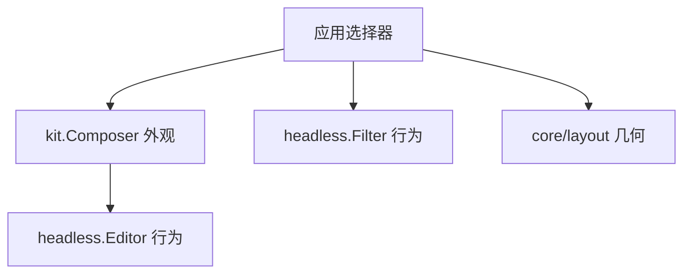

# 组合一个可换主题的选择器

语言：[English](../components.md) | 简体中文

本教程把核心组件契约扩展成可复用的界面，同时不把产品策略交给库。你将组合文本编辑器、
模糊过滤、布局、焦点、指针路由和适配终端的主题。

完整代码：[`examples/picker`](https://github.com/Tangerg/oolong/tree/main/examples/picker)

## 开始之前

请先完成[构建第一个界面](getting-started.md)。本教程假定你已经理解
`program.Run`、`Draw` 和 `Handle` 如何配合。

在 `core` 之外添加组件模块：

```sh
go get github.com/Tangerg/oolong/core@latest
go get github.com/Tangerg/oolong/components@latest
```

请同步升级这两个模块。Oolong 的模块共享同一个协调发布版本。

## 让每一层只决定一件事

选择器是由较小的框架组件组合出的产品组件：



`Filter` 拥有匹配、选择和滚动，但不拥有查询编辑器或行的外观。应用必须拥有后两者，
因为只有应用知道查询应该放在哪里，以及选中一个项目意味着什么。

## 一次性解析终端事实

从当前运行时所驱动的终端构造外观。不要在组件内读取进程环境变量，因为本地会话与 SSH
会话可能描述不同的终端。

```go
func newPicker(runtime *program.Runtime, items []string) *picker {
    theme := kit.Suited(runtime.Environment().Ground())
    glyphs := kit.GlyphsFor(runtime.Environment().Locale())

    p := &picker{runtime: runtime, theme: theme}
    p.query = kit.Composer{
        Theme:  theme,
        Prompt: glyphs.Marker + " ",
    }
    p.query.Editor().Placeholder = "type to narrow"
    p.configureItems(items)
    return p
}
```

`Theme` 命名 `Accent`、`Selection` 和 `Danger` 等语义角色。`Glyphs` 回答另一个问题：
这个终端能够表示哪些字符。

## 让过滤器拥有过滤行为

通过方法配置会改变状态的行为。`SetItems` 将值与“如何将值读成文本”的投影作为同一
数据源一起替换，`SetPattern` 再收窄该数据源。两者都会使缓存的排序失效，因此不存在
数据与投影不一致的中间状态，也不会让过时结果继续可见。
两种变更都会先完成匹配再发布。文本投影发生 panic 时，原有数据源、查询、匹配与光标
保持完整；投影必须是纯函数，不能重入该 Filter 的 SetItems 或 SetPattern。

```go
func (p *picker) configureItems(items []string) {
    p.list = &headless.Filter[string]{
        Row: p.drawRow,
    }
    p.list.SetItems(items, func(item string) string { return item })
}
```

行回调是外观接缝。它会收到项目、模糊匹配偏移和选中状态。若要用另一种形状绘制同一
行为，请替换这个回调，而不是替换 `Filter`。

## 绘制被动图表

图表是已完成内容，不是控制器。`Sparkline` 与 `BarChart` 直接绘制到 `grid.View`，实现
`headless.Block`，但不拥有选择、时钟或历史。应用继续持有测量数据，并决定它们何时
变化。

```go
trend := kit.Sparkline{
    Theme: theme, Glyphs: glyphs,
    Values: []float64{0.12, 0.18, 0.15, 0.24, 0.31},
    Minimum: 0, Maximum: 1,
}

usage := kit.BarChart{
    Theme: theme, Glyphs: glyphs, Maximum: 100,
    Bars: []kit.Bar{
        {Label: "CPU", Value: 42, Text: "42%"},
        {Label: "RAM", Value: 68, Text: "68%"},
    },
}
```

Sparkline 使用能够放入视口的最新样本。有效的 `Minimum`/`Maximum` 组合会固定量程，
完成度与资源指标通常需要这种语义；两个字段取零时则从可见窗口推导刻度。BarChart
有意只做水平、非负图表：它解决带标签的仪表盘比较，而不引入坐标轴、画布或约束
求解器。任一图表都可以通过 `headless.Static`、转录区、面板正文或应用自己的布局进行组合。

## 划分已分配的区域

无外观组件绘制到 `headless.Frame`。它既携带核心组件使用的裁剪后网格视图，也携带
输入几何所需的事务。

```go
func (p *picker) Draw(frame headless.Frame) {
    rows := frame.Subs((layout.Flow{Axis: layout.Down}).Rects(frame.Bounds().Size(), []layout.Slot{
        {Size: layout.Fixed(1)},
        {Size: layout.Flex(1)},
        {Size: layout.Fixed(1)},
    }))
    p.query.Draw(rows[0])
    p.list.Draw(rows[1])
    kit.Label{
        Text:  fmt.Sprintf("%d of %d", p.list.Matched(), p.list.Len()),
        Style: p.theme.Subtle,
    }.Draw(rows[2].View)
}
```

应用决定纵向组合，两个子组件都不需要知道上下还有什么。把槽位改为 `layout.Across`
即可得到双栏界面，无需修改任何子组件。

## 按所有权路由事件

把导航键交给列表，把文本输入交给编辑器。“已处理”与“已改变”是两个事实：在空编辑器
开头按 Backspace 会被处理，但不会改变任何内容。在输入前后比较 `Editor.Revision`，只在
语义内容真的变化时发布过滤模式，无需根据按键或 action 名称猜测。

子回调替换附件或改变外层焦点后，内置容器会消费被中断的旧按键或 action。
即使随后又回到原附件或原焦点，旧操作也不能重新取得冒泡权限。路由作用域未变时，
仍可正常拒绝输入。Root 使用已提交组件树的身份；只替换待绘制内容不会改变输入作用域。

```go
func (p *picker) Handle(event input.Event) bool {
    if key, ok := event.(input.Key); ok && key.Down() {
        switch key.Code {
        case input.Enter:
            p.choose()
            return true
        case input.Up, input.Down, input.PageUp, input.PageDown:
            return p.list.Handle(event)
        }
    }
    before := p.query.Editor().Revision()
    handled := p.query.Handle(event)
    if p.query.Editor().Revision() != before {
        p.list.SetPattern(p.query.Editor().Text())
    }
    return handled
}
```

对于指针输入，请在 `Draw` 期间把子区域暂存到 `headless.Snapshot`，再在 `Handle` 中根据
`Snapshot.Value` 路由。快照只会在完整根帧成功后变为可见，所以事件永远不会看到一半
新、一半旧的布局。完整选择器演示了这一模式。

## 安装无外观根节点

`headless.NewRoot` 是从实时无外观树到 `program.Component` 的唯一桥梁。它会原子交付
所有嵌套的呈现快照。

```go
err := program.Run(context.Background(), program.Config{
    Root: func(runtime *program.Runtime) program.Component {
        return headless.NewRoot(newPicker(runtime, files()))
    },
    Terminal: term.Features{Probe: true, Mouse: true},
})
```

`program.Config.Terminal` 只接受可选的 `term.Features`。`Root` 已经表示拥有备用屏幕，
`Inline` 已经表示使用终端普通屏幕，因此不存在需要保持一致的第二个 `AltScreen` 开关。
传输适配器在取得底层终端会话时使用 `program.Config.TerminalConfig()`。

已完成的 Markdown 文档等被动内容不需要该事务。只有在把它放进实时组件树时，才使用
`headless.Static` 适配。

## 在不改变行为的前提下换外观

复制主题值并替换语义角色：

```go
theme := kit.Suited(runtime.Environment().Ground())
theme.Accent = grid.Style{FG: grid.RGBColor(0xD7, 0x8B, 0xFF)}
theme.Selection = grid.Style{BG: grid.RGBColor(0x32, 0x27, 0x3B)}
```

把修改后的值传给 kit 组件，无外观状态不会改变。若要构建完全自定义的设计系统，请保留
`components/headless`，并用自己的包绘制每个外观接缝；`headless` 永远不会导入 `kit`。

## 明确值身份与导航意图

受控字段通过 accessor 提交编辑。在安装选项前设置 `Select.Same` 或
`MultiSelect.Same`；普通可比较值可以使用 `headless.Equal[T]`。标签只负责显示，
翻译标签不会改变选中值的身份。`Chosen`、`Taken` 和 `Ask` 只投影状态。
Select 直接读取 owner，无需 Sync。Text.Sync 协调编辑模型；MultiSelect.Sync
在显式语义边界规范化调用方的选中集合。

SetOptions 先完成身份比较和必要的绑定读取，再替换字段的选项与选择。
准备阶段 panic 或退出 goroutine 会保留原字段。选项安装后，规范化只向受控 accessor
提交提案；已接受答案仍由该 accessor 拥有。

通过 `NewText(TextConfig{Value: ...})`、`NewSelect(SelectConfig[T]{Value: ...})`、
`NewMultiSelect(MultiSelectConfig[T]{Value: ...})` 或 `NewConfirm(ConfirmConfig{Value: ...})`
构造受控字段。绑定引用保持私有，后续只通过 SetBinding 转移；它会取消旧键序列，
使旧校验失效。传入 nil 则把已接受的答案保留为本地状态。Accessor 可以包含函数、map
或切片，无需指针或可比较身份限制。

绑定转移先完成必要的读取和身份比较，再发布新 owner。异常退出保留原 owner、历史和校验。
替换没有未完成写入的 accessor 不读取已放弃的答案；交回本地状态时才读取旧 owner 的已接受答案。
Text 在转移所有权前结算尚未完成的编辑。

Accessor 回调返回后，Select 和 MultiSelect 只投影当前 owner，也支持交回本地状态。
受控 Select 和 MultiSelect 不保存可写的答案镜像；导航、Toggle 和 Reply
只向 accessor 提交独立提案。不可用的单选答案投影为首项；Validate 或替换已有选项
会向 owner 提交该项，被拒绝后仍属于无效绑定。调用方改变单选答案后，下一帧会显示其所在行。
MultiSelect 不会在 Set 尚未结束时再次提交同一规范化请求。如果规范化回调开始新语义操作，
旧 Do 或 Toggle 在分派前返回 false，Handle 消费中断的事件，Reply 则在应用旧答案前
返回 `headless.ErrValidationSuperseded`。
未完成的写入属于对应绑定的生命周期；切换绑定后，新 owner 可以立即完成自己的规范化。

字段先接收并转发焦点，再协调答案。Accessor 发布新答案不能拒绝父级已经发出的焦点通知。
只有仍有效的焦点转移可以启动失焦校验；后续转移，包括离开后又返回，会撤销旧转移
尚未启动的校验。重复通知相同焦点状态不会产生额外的失焦校验。校验一旦开始，
受检答案的有效性由校验自身拥有，与焦点独立。

校验结果的发布权属于字段。回调中开始新的校验、回复或改变受检答案时，旧 Validate 和 Reply
返回 `headless.ErrValidationSuperseded`，保留最近已发布的字段错误。
Form 的 `Set`、`Add`、`Cancel` 和新的 `Submit` 会撤销正在进行的旧提交；
旧提交返回 false，不再继续校验或调用 `Done`。替换或添加字段也会清除表单错误。
`Field.Validation` 返回最近成功校验的纯读取凭据；没有有效结果时返回 nil。
新的校验或不同的答案会使旧凭据失效。Form 保留凭据，直到后续字段和表单回调结束，
只有全部仍有效时才完成提交。自定义字段必须实现该契约；Form 不访问或拥有字段答案，
也不重试失效的校验。
Accessor 拒绝规范化并保留无效值时，校验返回 `headless.ErrInvalidBinding`。
单行显示、候选选项和过滤后的集合都不能代替应用实际接受的答案完成提交。

`Text` 直接提供文本、光标、遮罩、剪贴板、行旁装饰和光标样式。通过 `SetText`、
`SetCursor`、`Handle` 或 `Do` 编辑，使结果经过 accessor 的接受规则。
`Text` 不再暴露内部 Editor。`kit.Composer` 是编辑器的外观包装，仍然公开它的 Editor。

重入的 Text 操作先按 accessor 已接受的值结算正在提交的编辑，旧调用不能回滚新光标，
也不能再次提交新编辑。若同步期间出现新操作，`Text.Do` 会在分派前返回 false。
Accessor 写入发生 panic 或退出 goroutine 时，Text 按已接受的值结算草稿、revision 和历史。
若该值也无法读取，编辑会保留结算记录，直到下一次语义操作能够读取它。结算不吞掉异常退出。
Text 的 SetBinding 会重新开始历史并清除旧选区，undo 和尚未结束的 Cut 都不能
把旧 owner 的编辑写给新 owner。
剪贴板回调修改内容或选区后，`Editor.Cut` 返回 false；复制旧选区不能授权删除新选区。

列表选择变化和 Editor 光标导航都只请求显示一次。`Scroll.Reveal` 会保留到完整帧提交，中断绘制不会丢失请求。
后续手动滚动优先，`Scroll.FollowingEnd` 表示跟随末尾的策略。
`kit.Transcript.Current` 只改变匹配高亮，跳转请调用 `RevealMatch(index)`。
Editor 请求在下一帧的实际换行宽度下解析；已完成导航后的尺寸变化保留手动滚动位置。
Filter 查询重置会回到第一个结果。

Transcript 的按下与滚轮输入使用最后完整帧的可见单元格和目标；拖动延伸也只落在
这些可见单元格内。替换已呈现的 Content 或 Selection 会终止旧手势的坐标生命周期和连续点击，
即使后来切回原目标也不会恢复旧拖动；松开仍然结束原选择的拖动状态。
更换 Scroll 后，滚轮在替换帧提交时才转向新目标。

容器中的孩子需要移动时，应设置稳定 Key 并保留同一组件实例。`FocusIndex` 接受当前集合
索引；指针输入按已呈现的实例身份定位，移除或替换孩子后不会把旧点击或捕获交给新实例。
需要跨 `Set` 保持身份的组件应使用指针。

每个控件拥有自己的 `Pointer`。Draw 中调用 `Stage(frame, area)`；事件处理中调用
`Handle` 和 `Clicked(button)`。绘制只读取 `Over()`、`Pressing()`，快速按下再松开
不需要中间绘制一帧。`PointerRegion` 根据孩子的连续呈现生命周期路由：孩子消失后重新
出现，也不会接回旧手势。Tabs 和 Viewport 使用同一规则。

输入转向其他目标时，路由器向旧目标发送 `input.MouseLeave`。自定义控件应清除悬停，
保留已经接受的捕获；`Pointer.Handle` 会自动处理。焦点和路由转移在调用回调前发布
新 owner，通知结束后重新检查目标是否仍然有效。

新按下替换旧手势时，路由器向旧接收者发送 `input.MouseCancel`，包括按下处理尚未
返回的接收者。自定义控件应结束手势且不产生点击，`Pointer.Handle` 会自动处理。
Stack 的 base 和弹层共享一个捕获拥有者。新输入使用提交帧的可见裁切区；已经接受
的拖动和释放仍可在区域外继续。

明确属于其他按钮的拖动不能推进已捕获的手势；`input.Mouse.Drags` 和
`Mouse.Releases` 提供统一的按钮匹配规则。字段包装层只转换坐标并转发生命周期事件，
内部 List 或 Editor 拥有已接受的手势和可见命中区域。答案区域外的释放、标签上的新按下
以及失焦都会到达这个拥有者。同一 pane 的多个 attachment 不会让它同时收到获焦和失焦通知。

明确属于其他按钮的释放不会结束当前捕获。`input.ButtonNone` 的释放没有指明按钮，
会结束当前按下。拖出区域再拖回，匹配的释放仍可完成点击；拖动是否禁止激活由应用决定。

`List.SetItems` 后，鼠标选择等待新集合完成绘制。
拖动必须先有可见行接受的主按钮按下；孤立拖动、被拒绝的按下后发生的拖动都不能改变
选择或绑定字段值。
`List.Hit(point)` 接受列表局部坐标，原点是列表的逻辑帧，不是可见裁切区。
它只查询最后提交帧，不改变选择或滚动。
它拒绝可见矩形四边以外、被裁切或空白的行，以及替换集合后尚未绘制
的命中。改变滚动但尚未绘制时，查询仍对应屏幕上的行。`Filter.Hit(point)` 返回匹配
结果中的索引，与 `Selected` 和行渲染回调一致；它直接使用内部 List 的查询。

自定义控件用 `keymap.Matcher.Reset(change)` 替换待定绑定所对应的状态：先撤销匹配，
完成整个状态变更后再取消旧 resolver，不会清除变更期间启动的新匹配。
返回 false 表示已被更新的匹配或绑定取代，输入处理应停止旧事件的后续派发。
Filter 只在 source 和 pattern 的 setter 中重建匹配。它与 Table 都在集合及游标变更
全部完成后取消旧按键 resolver；读取集合不能完成或发起另一条替换路径。
Table 比较回调必须纯净并定义严格弱序。行、游标与排序标记在比较成功后一起发布；
比较 panic 保留原行、比较函数与排序状态。比较中重入 SetItems、SetLess、SortBy 或
ClearSort 会在改变它们之前 panic。
Stack 键盘输入只属于焦点拥有者，并在该拥有者已呈现后才被接受。旧帧不能激活已失焦
的孩子，也不能关闭尚未呈现的替换层。指针输入使用绘制提交的几何。

自定义页签条用 `Tabs.SelectPresented(index)` 处理已提交页签条上的点击；`Tabs.Select(index)`
仍然用于当前集合中的程序导航。修改按键绑定会取消未完成序列；替换选项集合或模态层时，
新对象不会继承延迟动作。Settings 的值编辑始终属于开始该按键序列时的那一行。

Dialog 的成员身份由控制器拥有。使用 Show、Dismiss、Sync；把 `Dialog.Content()`
或嵌入它的包装对象交给 `Stack.Push` 会在插入前 panic。

`Completion.Renderer` 同时提供 `DrawRow` 与 `Width`，可以替换完整候选行布局。
`Select.Row` 和 `MultiSelect.Row` 可自定义单行选项。外部字段实现
`ThemedField.DrawWith` 后，就能通过与内置字段相同的通道接收该帧的 Form 外观。

若按键取消回调开始了新的候选提供或关闭操作，`Completion.Dismiss` 返回 false。
调用方必须停止推进旧候选；内置接受操作会检查该结果，再决定是否调用旧候选及 token 的回调。

`kit.Paragraph` 在 `SetText` 或 `SetLinks` 成功后一起发布正文和检测出的链接。
`LinkConfig.Exists` 可以检查文件系统、读取上一次完整发布的段落，但不能重入这两个设置方法。
链接检测 panic 时，原正文、链接策略、链接与排版保持不变。

## 保存结构化输入历史

条目携带附件身份或其他结构化值时，使用 `headless.History[T]`。History 拥有有界序列、
历史游标和第一次成功 `Back` 时保存的草稿；应用决定空消息的含义，以及何时调用 `Add`。

在构造时配置值的所有权边界：

```go
type promptEntry struct {
    Text          string
    AttachmentIDs []string
}

history := headless.NewHistory(headless.HistoryConfig[promptEntry]{
    Limit: 100,
    Clone: func(entry promptEntry) promptEntry {
        entry.AttachmentIDs = slices.Clone(entry.AttachmentIDs)
        return entry
    },
    Equal: func(a, b promptEntry) bool {
        return a.Text == b.Text && slices.Equal(a.AttachmentIDs, b.AttachmentIDs)
    },
})
```

`Clone` 必须复制值中的所有可变引用，包括条目包含的嵌套切片、map 或指针指向的数据。
它必须是观察上纯粹的复制，不修改入参，也不产生外部副作用。
History 在保存入参和返回已保存条目时使用它。示例中的字符串不可变，因此复制附件切片
即可。`Clone: nil` 使用普通赋值，适用于不可变值。`Equal: nil` 保留每个条目，包括连续
重复值；配置相等判断后只压制相邻的相等条目，不会删除更早的重复项或改变顺序。
相等判断必须是观察上纯粹的，只读借用入参。复制与相等策略在整个 History 生命周期内固定。

`Back(current)` 只在第一次成功后退时保存完整草稿。`Forward()` 越过最新条目时返回草稿，
`Cancel()` 则立即返回草稿；两者结束遍历时都会释放 History 对草稿的引用。成功的 `Add` 会结束
当前遍历，即使新条目因相等判断而被去重。`At(1)` 读取最新条目，不移动游标。
`SetLimit(0)` 恢复默认的 1,000 条上限，负数上限会 panic。若缩容淘汰了当前浏览的条目，
下一次 `Forward` 会先到最早仍被保留的条目，再依次前进到较新条目和草稿。

新增条目和游标移动只在复制与相等判断成功后提交。回调发生 panic 或退出 goroutine 时，
条目、游标与保存的草稿保持不变，原始退出继续传播。

搜索使用独立于身份判断的显示投影：

```go
matches := history.Recall("readme", func(entry promptEntry) string {
    return entry.Text
})
```

每个 `Recalled[promptEntry]` 包含条目快照、用于 `At` 的 `Step` 和投影文本中的匹配字节偏移。
结果保持从新到旧的顺序，相同显示文字仍可对应不同附件。投影只读借用条目。空查询返回
所有条目而不调用投影；非空查询配合 nil 投影不会匹配任何条目。搜索不改变当前遍历。

字符串调用方把 `History` 改为 `History[string]`，使用
`HistoryConfig[string]{Clone: strings.Clone, Equal: headless.Equal[string]}` 构造，
并给 `Recall` 传入返回原字符串的投影。History 现在接受空值和空白文本，因此提交校验应
留在调用方。零值 `History[T]` 使用默认容量、普通赋值和不去重语义。通过指针保留 History，
在所属 goroutine 中使用；开始使用后不得复制，也不能并发访问。

[composer 示例](https://github.com/Tangerg/oolong/tree/main/examples/composer)
把文本和粘贴内容放入同一个 `History[draft]`，不再需要按显示文本建键的旁路 map，也不再
维护第二套草稿恢复状态。

## 搜索 transcript 快照

`headless.Search` 在 worker 上扫描 transcript 快照。在 transcript 的事件拥有者上调用
Submit，在 worker 上接收 Results，再把结果应用派发回同一个拥有者。紧接着应用结果之前，
检查 `result.Current()`，Close 也在该拥有者上串行执行。Search 拥有提交身份，Query 只是显示文字。重复相同查询、改变模式
或语料、清空查询、提交 nil transcript 或调用 Close，都会撤销旧收据，包括已经取走的结果。
比较 Query 或在接收 worker 上检查收据，无法保护稍后执行的拥有者回调。Close 等待扫描器
结束并关闭 Results。

## 运行并验证这个切片

```sh
go run ./examples/picker
cd examples && go test ./picker
```

现在你已经掌握组件层组合模型。接下来可以阅读
[渲染 Markdown、代码与数学公式](content.md)以添加被动内容，或阅读
[构建有界流式输出](streaming.md)以连接后台工作。
